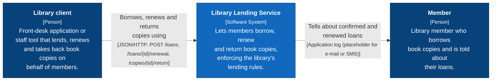
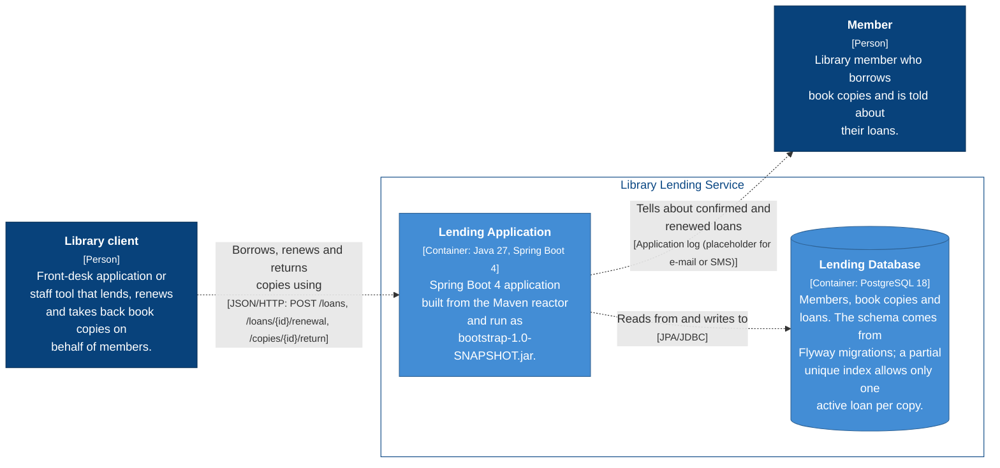
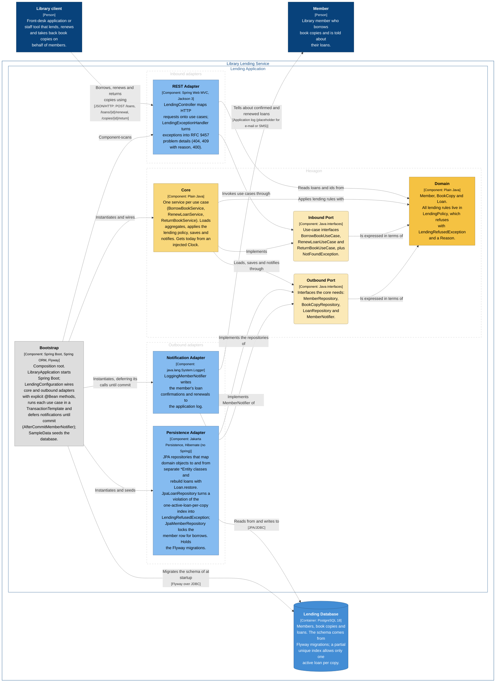
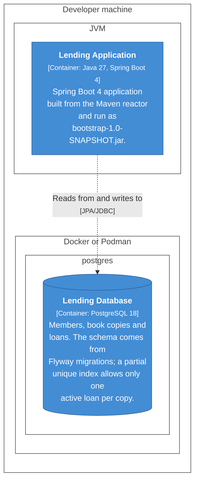

# Architecture

The Library Lending Service lets members borrow, renew and return book copies over a REST API. It is built with the hexagonal (ports and adapters) architecture: the lending rules and use cases are plain Java in the middle, and everything that talks to the outside world (HTTP, PostgreSQL, notifications) is an adapter around them.

This page follows the [C4 model](https://c4model.com), from the system's surroundings down to its components. The diagrams are generated from [`workspace.dsl`](workspace.dsl), a [Structurizr DSL](https://docs.structurizr.com/dsl) model that is the source of truth; see [Keeping this page up to date](#keeping-this-page-up-to-date).

## 1. System context

<!-- diagram:SystemContext -->

<!-- /diagram:SystemContext -->

- The **library client** is whatever calls the REST API on members' behalf, such as a front-desk application. The service has no user interface of its own.
- **Members** are told when a loan is confirmed or renewed. For now the notification is written to the application log, which stands in for e-mail or SMS.

## 2. Containers

<!-- diagram:Containers -->

<!-- /diagram:Containers -->

The service is deployed as one Spring Boot application with its own PostgreSQL database.

| Container | Technology | Responsibility |
|---|---|---|
| Lending Application | Java 27, Spring Boot 4 | Serves the REST API and runs the use cases. Built as `bootstrap/target/bootstrap-1.0-SNAPSHOT.jar`. |
| Lending Database | PostgreSQL 18 | Stores members, book copies and loans. The schema comes from Flyway migrations; a partial unique index allows only one active loan per copy. |

## 3. Components

<!-- diagram:Components -->

<!-- /diagram:Components -->

Each component is one Maven module, and each module has its own root package under `com.wixia.library`.

| Component | Maven module | Responsibility |
|---|---|---|
| REST Adapter | `com.wixia.inbound:adapter-rest` | `LendingController` maps HTTP requests onto use cases. `LendingExceptionHandler` turns exceptions into [RFC 9457](https://www.rfc-editor.org/rfc/rfc9457) problem details: 400, 404, and 409 with a `reason`. |
| Inbound Port | `com.wixia.inbound:inbound-port` | Use-case interfaces: `BorrowBookUseCase`, `RenewLoanUseCase`, `ReturnBookUseCase`. |
| Core | `com.wixia:core` | One service per use case. Loads aggregates, applies the lending policy, saves and notifies. |
| Domain | `com.wixia:domain` | `Member`, `BookCopy` and `Loan`. All lending rules are in `LendingPolicy`. |
| Outbound Port | `com.wixia.outbound:outbound-port` | What the core needs from outside: `MemberRepository`, `BookCopyRepository`, `LoanRepository`, `MemberNotifier`. |
| Persistence Adapter | `com.wixia.outbound:adapter-persistence` | JPA repositories over separate entity classes, and the Flyway migrations. |
| Notification Adapter | `com.wixia.outbound:adapter-notification` | `LoggingMemberNotifier`, which writes notifications to the log. |
| Bootstrap | `com.wixia:bootstrap` | Composition root. Starts Spring Boot, wires everything together and owns the transactions. |

### Dependency rules

The arrows between components show both what calls what and which way the compile-time dependencies may go. They all point inwards:

- Adapters depend on ports, never the other way round, and the inbound and outbound sides never depend on each other.
- `core` uses only the two ports. It *implements* the inbound port, so the REST adapter reaches it only through the use-case interfaces.
- `domain` depends on no other module.
- `domain`, the ports and `core` can't use Spring. Spring is used only in the adapters and `bootstrap`.
- `bootstrap` is the only module that sees everything.

`maven-enforcer-plugin` checks these rules in Maven's `validate` phase, including transitive and test-scope dependencies, so a forbidden dependency fails the build. Run `mvn validate` to check them on their own.

### How a borrow goes through the components

1. The **REST adapter** receives `POST /loans`, checks that `memberId` and `copyId` are present, and calls `BorrowBookUseCase`.
2. **Bootstrap** has wired that interface to `BorrowBookService` inside a transaction (`TransactionTemplate`). The core itself knows nothing about transactions.
3. **Core** loads the member with a row lock, so concurrent borrows by one member are checked one after the other. It then loads the copy and the member's active loans through the **outbound port**.
4. The **domain**'s `LendingPolicy` decides whether the loan may start. If not, it throws `LendingRefusedException` with a reason, such as `LOAN_LIMIT_REACHED`.
5. The **persistence adapter** saves the loan. If another request lent the same copy in the meantime, the database's unique index rejects the loan, and the adapter turns that into `COPY_ON_LOAN`.
6. The **notification adapter** is called through `MemberNotifier`, but bootstrap holds the notification back until the transaction commits. Nothing is sent for a borrow that is rolled back.
7. The REST adapter answers `201 Created` with the loan, or with a problem detail if any step refused.

## 4. Deployment

<!-- diagram:LocalDeployment -->

<!-- /diagram:LocalDeployment -->

The only deployment environment is a developer machine:

```bash
docker compose up -d                                 # PostgreSQL on localhost:5432
mvn package -DskipTests
java -jar bootstrap/target/bootstrap-1.0-SNAPSHOT.jar
```

Flyway creates the schema when the application starts. The tests and `mvn spring-boot:test-run -pl bootstrap` use a throwaway PostgreSQL container from Testcontainers instead, which isn't shown here.

## Keeping this page up to date

[`workspace.dsl`](workspace.dsl) is the source of truth. After changing the model, regenerate the diagrams on this page:

```bash
docs/architecture/export-diagrams.sh
```

The script exports each view as Mermaid, using the `structurizr/structurizr` image under Docker or Podman. It writes each diagram between the `<!-- diagram:… -->` markers above, so don't edit the diagrams by hand.

To browse and arrange the views interactively, serve the folder with Structurizr and open http://localhost:8080:

```bash
docker run -it --rm -p 8080:8080 -v "$PWD/docs/architecture:/usr/local/structurizr" structurizr/structurizr local
```

Under rootless Podman, add `--userns=keep-id:uid=65532,gid=65532` so the container can write to the folder. Structurizr saves the layout to `workspace.json`, which is committed. Every view currently uses `autolayout`, so remove that line from a view first if its arranged layout should be kept.

For the reasons behind these design decisions, see [`../dev-log.md`](../dev-log.md).
